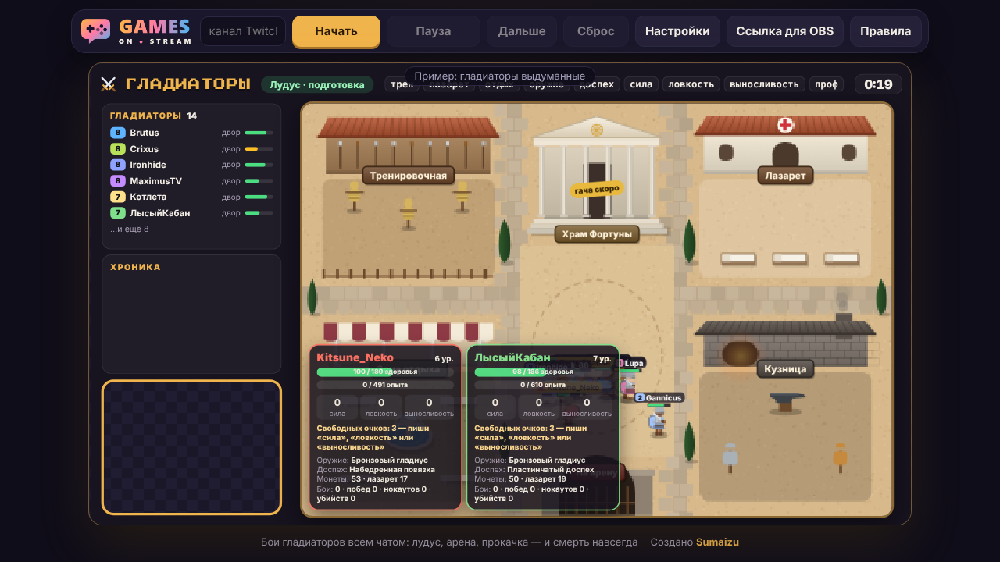
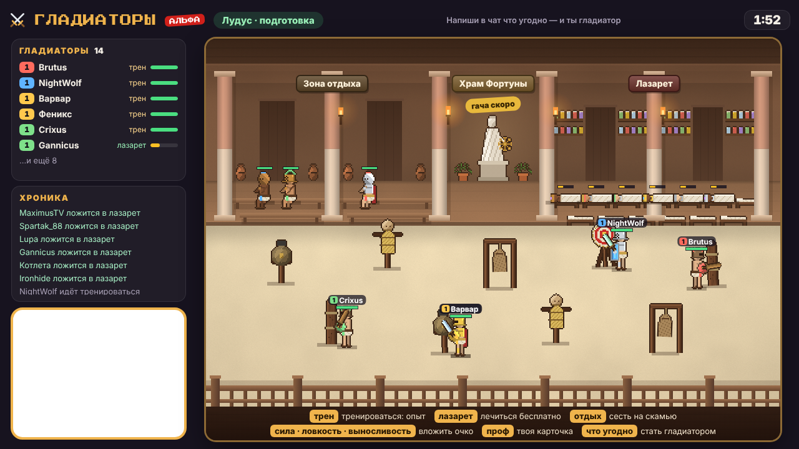

# Гладиаторы

**Тестовая альфа-версия** — возможны ошибки, баланс и правила ещё будут меняться.

Игра для чата Twitch на русском языке. Зрители пишут в чат — и становятся гладиаторами: готовятся к бою в лудусе,
а потом выходят на арену и дерутся все против всех. Опыт, монеты и снаряжение копятся от боя к бою — но погибший
гладиатор пропадает навсегда.

**[gamesonstream.ru/gladiatory](https://gamesonstream.ru/gladiatory/)** — играй прямо в браузере или вставь ссылку в
OBS.

Ставить ничего не нужно: ни программ, ни регистрации, ни ключей Twitch. Зрителям тоже — они играют, просто написав в
чат.

## Как запустить

**В браузере.** Открой [gamesonstream.ru/gladiatory](https://gamesonstream.ru/gladiatory/), впиши сверху свой канал
Twitch и нажми «Начать». Пока игра не начата, на её месте пример с выдуманными гладиаторами.

- **«Пауза»** замораживает игру, «Продолжить» возвращает её.
- **«Дальше»** не ждёт отсчёта: сразу бой, итоги или лудус.
- **«Сброс»** стирает всех гладиаторов канала. Нажать нужно дважды — чтобы не задеть случайно.

**В OBS.** Нажми «Ссылка для OBS», скопируй ссылку и вставь её в источник «Браузер»: ширина 1920, высота 1080. Игра
начнётся сама, как только источник появится на экране. Скрыл источник — игра на паузе.

- **Вебка.** Окошко под вебку слева внизу, того же размера и на том же месте, что и в других играх сайта. Оно
  прозрачное: поставь камеру в OBS под оверлей.
- **Гладиаторы хранятся в OBS** (в браузере источника), отдельно для каждого канала.
- **Настройки зашиты в ссылку.** Поменял настройки — вставь в OBS новую ссылку.

## Как играть

1. **Лудус** (минута). Напиши в чат что угодно — и ты гладиатор: 100 монет и 3 очка характеристик. Пока идёт
   отсчёт, готовься к бою:
   - `трен` — тренировочная: опыт, но раны не лечатся;
   - `лазарет` — бесплатное лечение, быстрее отдыха; после боя раненые идут сюда, а вылечившись — тренироваться;
   - `отдых` — сесть на скамью и не выходить в бои, а смотреть (ставить на дуэль можно): раны затягиваются медленно.
     Сюда же садятся афк — кто 3 раунда подряд ничего не писал; написал что угодно — снова в лазарет или на тренировку;
   - `гача` — 30 монет: меч, двуручный меч или копьё, шлем, броня, поножи или сапоги (всё — пяти редкостей), щит,
     сеть, божественный амулет (пустых круток не бывает); `гача 3`, `гача все`; вещь надевается, только если лучше той, что в её слоте; монеты снимаются в момент прокрутки, а в последние
     5 секунд перед боем и в бою гача не крутится — очередь ждёт;
   - `сила`, `ловкость`, `выносливость` — вложить очко (`сила 3`, `сила все`); сами очки не тратятся;
   - `проф` — своя карточка на экране.
2. **Бой** (до 90 секунд). Все выходят на арену и дерутся сами, все против всех. Бой кончается, когда на ногах
   остался один или вышло время. `сдаюсь` — сдаться и точно выжить.
3. **Яма со львами.** С шансом 10% вместо обычного боя все гладиаторы вместе дерутся со львами: лев на каждые 2,5
   бойца (от 1 до 6), а сила львов (здоровье и урон) подстраивается под команду: сила стороны — сумма урона в секунду ×
   сумма живучести с бронёй, уклонением, щитом и с учётом текущего здоровья (раненые не долечились). Подобрано симуляцией так, что гладиаторы побеждают примерно в 9 боях
   из 10, но с потерями. От лап льва гибнут вдвое чаще, зато выжившие получают много опыта и золота.
4. **Дуэль.** С шансом 20% выходят двое случайных: первый слева, второй справа. 30 секунд остальные ставят `1` или
   `2`. Потом бой без смертей: обоим много опыта, победителю по 30 монет за каждую ставку против себя, угадавшим —
   по 100 монет.
5. **Испытание парагона.** Дорос до 10 уровня и провёл не меньше 30 боёв — следующий бой выходишь один против всех.
   Выжившим против тебя — много опыта. Ты сам, как бы ни кончился бой, получаешь парагон (золотой флажок с цифрой у ника,
   как в Чатобороне) и начинаешь заново с 1 уровня. Каждый парагон: +1 к стартовым очкам и +10 к стартовому золоту;
   парагон остаётся и после гибели.
6. **Поражение.** Гладиатор без здоровья падает и сдаётся — или получает смертельную травму и погибает (по умолчанию
   10%; от сильного добивающего удара — не больше чем в 1,25 раза выше). Погибший пропадает со всем прогрессом;
   написав в чат снова, зритель начинает новым бойцом. Крит с шансом 20% пускает кровь на 5 секунд: на бегу раненый
   теряет здоровье, а упав с кровотечением, гибнет в 1,5 раза чаще.
7. **Итоги.** Выстоявшие получают чуть больше опыта и монет, чем павшие и сдавшиеся, но живые; чемпион — ещё на
   четверть больше. Сверху всем выжившим — по 3 опыта и 2 монеты за каждый удар по врагу. Потом все возвращаются в лудус, раненых сразу уносят в лазарет.

Редкости в гаче выпадают в тех же пропорциях, что в Чатобороне (обычная 27 : редкая 20 : мифическая 10 : эпическая 7 :
легендарная 6), ещё бывают щит (4%), сеть (5%) и божественный амулет (3%). Пустых круток и монет нет.

### Команды стримера и модераторов

- `!гладиаторы-пауза` — пауза, ещё раз — продолжить
- `!гладиаторы-дальше` — не ждать отсчёта
- `!гладиаторы-сброс` — стереть всех гладиаторов

## Оружие

- **Кулаки** — с ними начинает каждый новичок: слабее, но чуть чаще. Первая гача гарантированно даёт оружие.
- **Меч** — обычный, без особенностей.
- **Двуручный меч** — реже, но сильнее, крит чаще, бьёт всех перед собой; щит с ним не работает.
- **Копьё** — бьёт дальше; в израненного беглеца его метают — брошенное, оно пробивает броню, — и бегут подбирать; снова метнуть можно через 5 секунд после подбора.
- **Щит** (без редкости) — отбивает примерно каждый третий удар (35%), раскалывается при этом с шансом 4%.
- **Сеть** (без редкости) — бросают во врага: он запутан на 3 секунды — не бьёт и не может убежать, — его добивают. Через 5 секунд сеть можно
  бросить снова, но после каждого броска она с шансом 15% рвётся.
- **Броня** — шлем, броня, поножи и сапоги, каждое в свой слот; вместе режут урон, но не больше чем на 60%.
- **Божественный амулет** — красный камень на груди. Один раз спасает от смерти и рассыпается; пока он есть, второй
  не выпадает.
- **Инвентарь** в карточке `проф`: правая и левая рука, голова, тело, штаны, ноги, амулет.
- Щит или сеть держат во второй руке — что-то одно. Пока она занята или в руках двуручник, ни щит, ни сеть из гачи
  не выпадают.

## Для разработки

Игра — статичные файлы в папке `gladiatory/` репозитория сайта, без сборки; всё для разработки лежит в `gladiatory/_dev/`. `_dev/site.bat` (или `python _dev/tools/serve.py`) открывает игру локально.
Тесты: `node _dev/tools/test.mjs` или `python _dev/tools/jstest.py` (нужны Edge или Chrome и `pip install websocket-client`).

## Лицензия

[PolyForm Noncommercial 1.0.0](LICENSE.md): код можно использовать и менять в некоммерческих целях. Играть на своих
стримах через [gamesonstream.ru/gladiatory](https://gamesonstream.ru/gladiatory/) можно бесплатно, в том числе на
монетизированных стримах.
